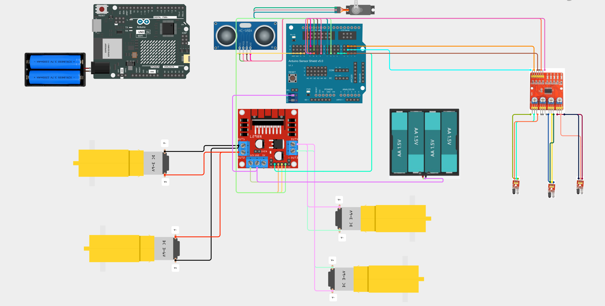
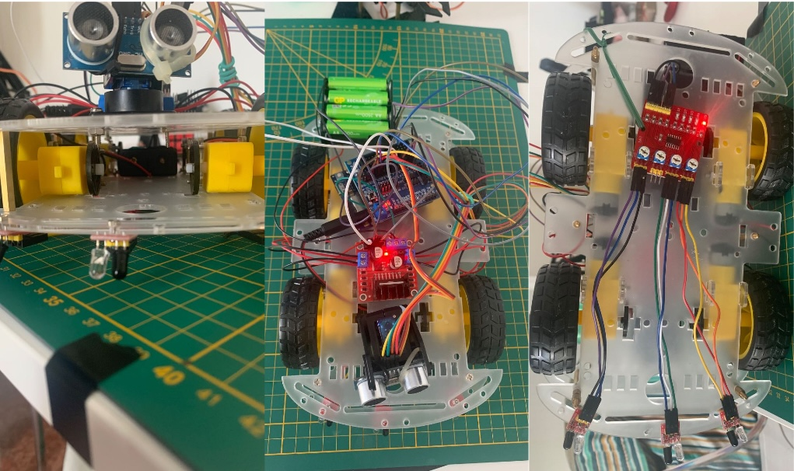
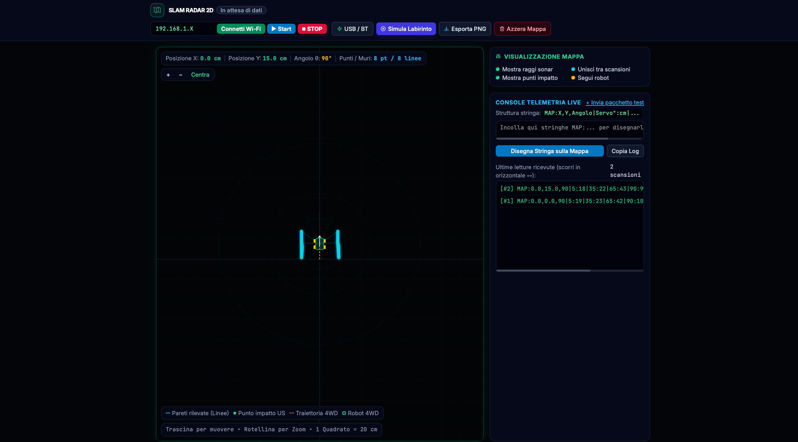

# Arduino R4 WiFi — 4WD SLAM Radar 2D Robot

Un robot esploratore autonomo a 4 ruote motrici basato su **Arduino UNO R4 WiFi**, progettato per navigare all'interno di percorsi e labirinti rilevando gli ostacoli circostanti. Il robot esegue scansioni radar a 180° tramite un sensore a ultrasuoni montato su servomotore e trasmette la telemetria in tempo reale via Wi-Fi (Simultaneous Localization and Mapping) a una **dashboard Web interattiva**, che ricostruisce la mappa vettoriale 2D delle pareti circostanti.


https://github.com/user-attachments/assets/4889db88-9c82-409c-ac4b-cb73f90703c8


---

## Cablaggio e Hardware

### Componenti Utilizzati
* **Microcontrollore:** Arduino UNO R4 WiFi + Sensor Shield V5.0
* **Telaio e Motori:** Chassis 4WD con 4 motoriduttori DC TT (gialli)
* **Driver Motori:** Modulo ponte H **L298N** (con jumper inseriti su `ENA` ed `ENB` per erogare il 100% di potenza)
* **Torretta Radar:** Sensore a ultrasuoni **HC-SR04** montato su micro-servomotore **SG90**
* **Odometria a Traguardi:** Modulo a **3 Sensori Infrarossi (IR)** posizionati sotto il telaio per il rilevamento di traguardi configurabili(nastri neri a distanza fissa sul pavimento)
* **Doppia Alimentazione Separata:**
  * **Logica (Arduino, Wi-Fi, Sensori, Servo):** Pacco batterie con **2 celle Li-Ion 18650** (7.4V – 8.4V) collegato al Barrel Jack dell'Arduino R4.
  * **Potenza (4 Motori DC):** Portapile da **4 batterie AA** collegato ai morsetti `12V/VMS` e `GND` del driver L298N (con massa `GND` in comune con la Sensor Shield e linea `+5V` scollegata per isolare i due circuiti).

### Mappa dei Pin su Sensor Shield

| Componente | Pin Modulo | Pin Arduino (Sensor Shield) | Funzione |
| :--- | :--- | :--- | :--- |
| **Driver L298N** | `IN1` | **Pin 4** | Direzione 1 Motore Sinistro |
| **Driver L298N** | `IN2` | **Pin 12** | Direzione 2 Motore Sinistro |
| **Driver L298N** | `IN3` | **Pin 13** | Direzione 1 Motore Destro |
| **Driver L298N** | `IN4` | **Pin 6** | Direzione 2 Motore Destro |
| **Driver L298N** | `ENA` / `ENB` | *Jumper Neri* | Abilitazione potenza 100% permanente |
| **Servo SG90** | VCC/GND/Segnale | **Colonna 7** | Rotazione torretta radar (`5°` – `175°`) |
| **HC-SR04** | `TRIG` | **Pin 8** | Impulso di trigger ultrasuoni |
| **HC-SR04** | `ECHO` | **Pin 9** | Lettura eco di ritorno ultrasuoni |
| **Sensori IR** | `IR_SX` (`IN1`) | **Pin 2** | Sensore IR Sinistro (lettura nastro nero) |
| **Sensori IR** | `IR_CENTRO` (`IN3`)| **Pin 10** | Sensore IR Centrale (lettura nastro nero) |
| **Sensori IR** | `IR_DX` (`IN4`) | **Pin 11** | Sensore IR Destro (lettura nastro nero) |

###

| Cablaggio |
| :---: |
|  | 

| Vista Completa del Robot 4WD |
| :---: |
 |

---

## Istruzioni per l'Uso


### 1 Caricamento dello Sketch Arduino
1 - Apri il file `4wd.ino` nell'Arduino IDE.
2 - Inserisci il nome della tua rete Wi-Fi (`ssid`) e la relativa password (`password`) nelle prime righe del codice.
3 - Collega l'Arduino R4 WiFi al computer tramite cavo USB-C e carica lo sketch sulla scheda.

### 2 Ottenimento dell'Indirizzo IP dal Monitor Seriale
1 - Una volta completato il caricamento, apri il **Monitor Seriale** dell'Arduino IDE e imposta la velocità a **`115200 baud`**.
2 - Attendi qualche secondo finché l'Arduino non si connette al router Wi-Fi.
3 - Copia l'**indirizzo IP locale** stampato a schermo nel monitor.
4 - Scollega il cavo USB e accendi le batterie (pacco 18650 su Arduino + pacco 4xAA sui motori).

### 3 Apertura dell'Interfaccia Web HTML
1 - Apri il file `map.html` direttamente sul browser del tuo PC/Mac.
   *(Nota per gli utenti Safari su Mac: dal menu in alto `Sviluppo`, abilita "Disabilita restrizioni sui file locali" per consentire alla pagina locale di comunicare via HTTP con l'IP del robot, oppure utilizza Google Chrome).*

2 - Nella barra in alto a sinistra della pagina web, incolla l'**indirizzo IP** del robot nell'apposita casella di testo e clicca su **"Connetti Wi-Fi"**.

| Pagina |
| :---: |
|  | 

### 4 Avvio e Arresto dell'Esplorazione 
* Premi il pulsante azzurro **`▶ Start`** nella barra superiore per ordinare al robot di iniziare la scansione e l'esplorazione autonoma del percorso.
* Premi il pulsante rosso **`⏹ STOP`** per interrompere istantaneamente la corsa dei motori e mettere in pausa il robot.

---

## Ciclo operativo

### Logica di Navigazione e Mappatura
Il ciclo operativo del robot si articola in 4 fasi sincronizzate:

1 - **Scansione Radar a 7 Angoli:** Da fermo, il robot ruota il servomotore SG90 su 7 angolazioni distribuite lungo tutto l'arco frontale (`5°`, `35°`, `65°`, `90°`, `115°`, `145°`, `175°`). Ad ogni step misura la distanza in centimetri tramite il sensore a ultrasuoni.

2 - **Navigazione Libera con Freno d'Emergenza Ultrasuoni** 

Il robot si muove sfruttando brevi scatti temporizzati nello spazio libero. Durante la marcia, un controllo ultrarapido interroga continuamente l'HC-SR04: se un muro scende sotto i 13 cm, il robot inchioda istantaneamente per evitare collisioni.

3 - **Manovra di Disimpegno Anti-Doppia Scansione:** 

Se rileva un ostacolo frontale ravvicinato, il robot arretra di `4.5 cm` (sottraendo lo spostamento dalle coordinate odometriche), osserva ai due estremi (`5°` estrema destra e `175°` estrema sinistra) e ruota verso il lato più libero. Per evitare di ridisegnare due volte lo stesso muro sovrapponendo le linee, il software inibisce l'invio di nuove scansioni finché il robot non ha completato un nuovo passo effettivo in avanti.

4 - **Rilevamento Traguardo Finale** 

I sensori IR monitorano passivamente il pavimento. Non appena intercettano l'unico nastro nero di fine percorso, il robot arresta i motori, notifica il completamento e trasmette il segnale di traguardo alla dashboard.

5 - **Pulizia Automatica della Traiettoria (Ray Casting in-browser):** 

La dashboard web traccia la scia del robot e rimuove in automatico tutti i punti di impatto registrati nel raggio di 9 cm dal passaggio, garantendo uno spazio centrale perfettamente sgombro da punti fantasma o artefatti spuri, evidenziando in modo pulito e continuo esclusivamente i muri perimetrali esterni del percorso.

---

### Formato dei Pacchetti `MAP`
La dashboard web interroga ciclicamente l'endpoint HTTP `http://<IP_ROBOT>/map` (dotato di header CORS `Access-Control-Allow-Origin: *`). Il robot risponde con una stringa formattata in questo modo:

```text
contatore#MAP:posX,posY,angoloTheta|ang1:dist1|ang2:dist2|ang3:dist3|ang4:dist4|ang5:dist5|ang6:dist6|ang7:dist7
```

**Esempio:**
`1#MAP:0.0,15.0,90.0|5:14|35:20|65:44|90:57|115:37|145:17|175:16`
* `0.0, 15.0, 90.0`: Il robot si trova a `X = 0.0 cm`, `Y = 15.0 cm` e punta a `90°`.
* `5:14`... `90:57`... `175:16`: Alle varie angolazioni del servomotore (da destra verso sinistra), il sonar ha rilevato le pareti laterali a `14 cm` e `16 cm` e il corridoio libero davanti a `57 cm`.

L'interfaccia HTML converte ciascuna coppia `(angoloServo, distanza)` in coordinate cartesiane globali tramite trigonometria ($\cos$ e $\sin$), disegnando i punti d'impatto verdi e collegandoli con segmenti vettoriali ciano.

---

## Problemi Riscontrati

1 - **Calo di Tensione all'Avvio dei Motori (Brownout Reset):**

   Alimentando Arduino R4 WiFi (tramite il regolatore interno a 5V del driver L298N) e i 4 motori DC con case di 4 batterie da 1.5V, il picco di corrente richiesto dallo spunto simultaneo delle 4 ruote faceva scendere la tensione sotto la soglia critica, causando il riavvio improvviso dell'Arduino e la perdita della connessione Wi-Fi subito dopo la prima scansione del servo.
   * **Soluzione:** Separazione fisica delle alimentazioni utilizzando **2 batterie Li-Ion 18650** sul jack dell'Arduino per la sola logica/Wi-Fi e **4 batterie AA** dedicate esclusivamente alla scheda L298N (mantenendo solo il riferimento `GND` in comune).

2 - **Conflitto Hardware tra Libreria `<Servo.h>` e PWM (`analogWrite`):**

   L'utilizzo della libreria `<Servo.h>` occupa i timer interni del microcontrollore, interferendo con la generazione del segnale PWM sul Pin 3 (`ENA`) e lasciando senza trazione le ruote del lato sinistro.
   * **Soluzione:** Reinserimento dei **ponticelli fisici (jumper)** su `ENA` ed `ENB` direttamente sulla scheda L298N, garantendo la massima coppia motrice via hardware per spostare il peso aggiuntivo delle batterie 18650 e liberando due pin digitali.

3 - **Latenza del Comando di STOP via Wi-Fi:**

   L'uso della funzione bloccante `delay()` durante l'avanzamento dei motori rendeva l'Arduino temporaneamente "sordo" alle richieste HTTP di arresto inviate dall'utente.
   * **Soluzione:** Sostituzione di tutti i `delay()` con una funzione asincrona personalizzata (`attendiConWiFi()`) basata su `millis()`, che interroga il server Wi-Fi ogni 5 millisecondi anche mentre le ruote girano, garantendo l'inchiodata istantanea dei motori alla pressione del tasto STOP.

4 - **Prevenzione dello Sfasamento a `-360°` e Filtro Falsi Echi HC-SR04:**
   
   In corridoi molto stretti, il sensore a ultrasuoni restituiva occasionalmente falsi echi istantanei sotto i 4 cm (rimbalzi sonori sul pavimento o vibrazioni), facendo entrare il robot in un loop continuo di retromarce e rotazioni senza inviare dati alla pagina web, accumulando sfasamenti errati dell'angolo `theta`.
   * **Soluzione:** Implementazione nello sketch di una **doppia verifica filtrata dei dati HC-SR04** (che scarta i falsi zeri e richiede una conferma consecutiva prima di confermare la presenza di un ostacolo) e normalizzazione continua dell'angolo di rotta tra `0°` e `360°`.

5 - **Eliminazione dei "Muri Fantasma" al Centro della Strada (Algoritmo Anti-Crossing):**
   
   Collegando sequenzialmente tutti i punti della scansione (da destra a sinistra), l'interfaccia HTML tracciava linee a "V" o segmenti trasversali che tagliavano a metà il corridoio calpestato dal robot.
    
   **Soluzione:**   
   * **Pulizia della Traiettoria (*Free Space Mapping*):** La dashboard traccia la scia del robot e rimuove automaticamente tutti i punti di scansione registrati nell'intorno immediato del passaggio (raggio di 9 cm), poiché lo spazio in cui il robot è transitato è per definizione libero.
   * **Separazione Rigorosa Destra/Sinistra:** L'algoritmo di unione dei segmenti (`computeWallSegments`) vieta di collegare punti appartenenti a lati opposti rispetto all'asse centrale dei `90°`. I punti di destra si uniscono solo con la destra, e quelli di sinistra solo con la sinistra, impedendo il cross-over al centro.Se una scansione perde temporaneamente il contatto con il muro laterale, il software ricuce automaticamente la parete agganciandosi al primo punto valido nelle scansioni successive, verificando geometricamente che il segmento generato non intersechi mai la traiettoria gialla calpestata dal robot 

6 - **Congelamento delle Coordinate in Caso di Blocco (Anti-Drift):**

   Se il robot si incastrava in un angolo e sgommava avanti e indietro, l'odometria a ciclo aperto continuava ad accumulare coordinate positive sulla mappa, facendo apparire il robot in movimento sul monitor mentre nella realtà era immobile.
   * **Soluzione:** Introduzione di una soglia di sicurezza minima sui passi: se il robot compie uno scatto in avanti ma viene fermato dal freno d'emergenza prima di aver percorso almeno 6 centimetri reali, il software **congela l'aggiornamento delle coordinate `(X, Y)`**, impedendo la deriva della mappa.

7 - **Memoria Direzionale in Curva (Anti-Inversione a U):**

   Affrontando curve strette a gomito che richiedono più scatti di rotazione consecutivi, il robot effettuava una nuova valutazione destra/sinistra a metà manovra. Trovandosi parzialmente ruotato, il sensore agli estremi (`5°` o `175°`) finiva per inquadrare il corridoio libero appena percorso alle proprie spalle, ingannando la logica di guida e portando il robot a invertire il senso di marcia tornando verso la partenza.
   * **Soluzione:** Introduzione di una variabile di stato con memoria direzionale (`direzioneInCorso`). Al rilevamento di un ostacolo frontale, il robot esegue un singolo arretramento, valuta l'apertura combinando gli estremi (`5°` e `175°`) con le diagonali (`35°` e `145°`) e **blocca in memoria la direzione scelta**. Negli step successivi, finché la visuale frontale (`90°`, `65°` e `115°`) non torna completamente sgombra, il robot è vincolato a proseguire la rotazione sul posto esclusivamente nel verso prestabilito, senza ulteriori retromarce né ripensamenti, azzerando la memoria solo a corsia libera imboccata.

---

### Conclusioni
Il progetto dimostra come, anche senza sensori LiDAR/encoder ottici sulle ruote, sia possibile realizzare un sistema SLAM 2D per mappare con successo percorsi ravvicinati e controllare il robot in totale sicurezza da qualsiasi browser web.
